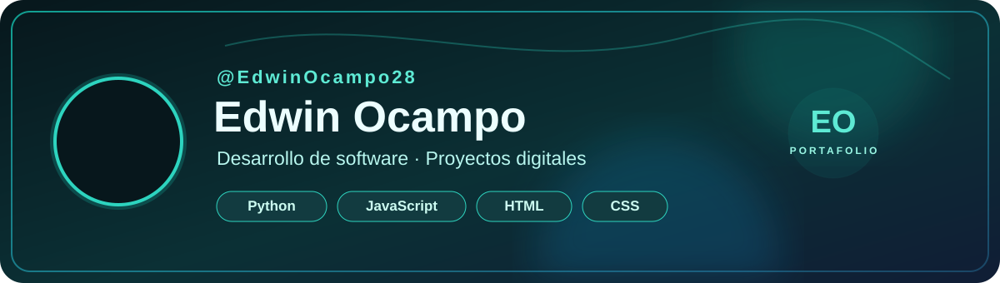

# 👋 ¡Hola! Soy Edwin Ocampo

**Desarrollador de proyectos digitales · Aprendiz de programación · Creador de soluciones**

Construyo aplicaciones web y herramientas para organizar procesos, gestionar información y crear experiencias interactivas.

  
  

---

## 🧑‍💻 Sobre mí

Me interesa aprender construyendo proyectos reales. He trabajado en aplicaciones de gestión, plataformas educativas, herramientas financieras, turismo y experiencias de juegos.

- 🧩 **Construyo:** aplicaciones y sistemas organizados por módulos.
- 🛠️ **Me enfoco en:** mejorar la utilidad, la presentación y la facilidad de uso de cada proyecto.
- 📚 **Aprendo practicando:** desarrollo web y programación con Python.
- 🎯 **Mi objetivo:** seguir creciendo como desarrollador y presentar mis proyectos a oportunidades laborales y emprendimientos.

---

## 🚀 Proyectos destacados

<table>
  <tr>
    <td width="50%">
      <h3>🎮 Juegos Arcade</h3>
      
Proyecto web de juegos y experiencias interactivas.

      <a href="https://github.com/EdwinOcampo28/Juegos_Arcade_Pagina_Web">Ver repositorio ↗</a>
    </td>
    <td width="50%">
      <h3>✈️ Turismo Internacional</h3>
      
Sistema para trabajar con cotizaciones, viajes e itinerarios.

      <a href="https://github.com/EdwinOcampo28/Sistema_Turismo_Internacional_Web">Ver repositorio ↗</a>
    </td>
  </tr>
  <tr>
    <td width="50%">
      <h3>🎓 Plataforma educativa</h3>
      
Proyecto LMS para organizar contenido y procesos educativos.

      <a href="https://github.com/EdwinOcampo28/LMS_Plataforma_Educativa">Ver repositorio ↗</a>
    </td>
    <td width="50%">
      <h3>🐍 Trabajos en Python</h3>
      
Repositorio de proyectos y prácticas desarrollados con Python.

      <a href="https://github.com/EdwinOcampo28/TodosLosTrabajospython">Ver repositorio ↗</a>
    </td>
  </tr>
</table>

### También estoy trabajando en ideas como:

- 💎 **Global Gold:** gestión para un negocio de joyería.
- 💰 **PRESTAMO+:** gestión de solicitudes, pagos y abonos.
- 📊 **Gestor de Gastos:** organización de ingresos y gastos.

*Estos nombres describen proyectos que he desarrollado; no todos tienen un repositorio público disponible.*

---

## 🧰 Tecnologías y herramientas

---

## 📌 Mi portafolio

Estoy preparando mi portafolio web personal para presentar mis proyectos de una forma visual y organizada.

👉 **[Explorar todos mis repositorios](https://github.com/EdwinOcampo28?tab=repositories)**

---

### ¡Gracias por visitar mi perfil! ✨

Aprendiendo, construyendo y mejorando proyecto a proyecto.

